# Introduction

Taking the first steps into embedding is not as easy as taking the first steps in programming. Depending on how you choose to write code, programming can be straightforward, install one tool and you're good. Of course, this will heavily depend on your system and language of choice, but it's possible to have less friction.

With embedded systems this is not the case. There is a whole toolchain you need to have available before seeing the first result. This post is about my first step in this world, I will describe the hardware I'm using, the steps I took to see the first LED turning on on my device.

## Choosing my hardware

My hardware of choice is the STM32F407VGT6 (the microcontroller) and the STM32F407VG-DISC1 (the development board).

I wanted to experiment with Arm® processors, work with peripherals, get close to bare-metal programming, manipulate hardware registers, eventually explore Real-Time Operating Systems (RTOS), and develop using C and C++.

The board is manufactured by [STMicroelectronics](https://www.st.com/).

This is the [link](https://estore.st.com/en/stm32f407g-disc1-cpn.html) to the development board I bought.


## What is an STM32?

An STM32 is a family of microcontrollers developed by STMicroelectronics. The specific model I bought features a 32-bit Arm® Cortex®-M4 core with a floating-point unit (FPU), 1 MByte of Flash memory (where we store the programs we write) and 192 KBytes of RAM.

It has several peripherals and components: 

* LEDs, 
* an omnidirectional digital microphone, 
* an accelerometer (which measures acceleration along three axes and can detect movement, orientation changes, tilting and vibration), 
* a user button (whose purpose we can configure) and a reset push button, 
* a DAC (Digital-to-Analog Converter, which converts digital audio signals into analog signals) with an integrated Class D speaker driver, 
* USB Micro-AB connectivity supporting USB OTG host/device operation (allowing us to connect to a computer or USB peripherals), 
* a stereo audio output jack, and 
* extension headers (which allow us to connect the microcontroller's I/O pins to external equipment).

It also offers flexible power-supply options, an on-board ST-LINK interface (which allows us to program and debug the microcontroller while connected to a computer), and software libraries and development tools.

Something that I didn't know, but that was interesting to understand is that the ST-LINK is **a separate microcontroller-based debugging and programming device** integrated into your Discovery board.

<!--  -->
<p align="center">
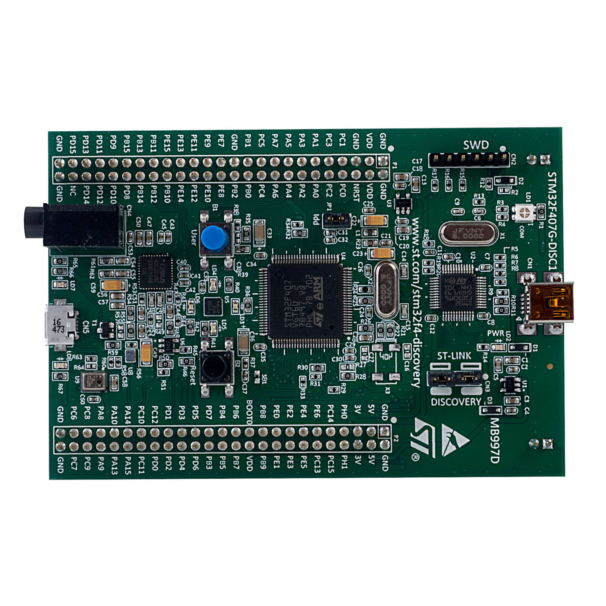
</p>

# Preliminaries

## Connection to the computer

Before defining a project, I wanted to turn the board on and check if everything was working. My plan was to connect it to my computer and verify it was working. It was here that I discovered I was missing a cable to connect to my computer. I had to stop everything and find a place to buy it.

Since I use a Mac M1, I needed a cable connecting my USB-C port to one of the availables port on my board. The [User Manual - UM1472](https://www.st.com/resource/en/user_manual/um1472-discovery-kit-with-stm32f407vg-mcu-stmicroelectronics.pdf) states this in page 11, "6.1 Getting Started", in item 2:

> *"Connect the STM32F4DISCOVERY board to a PC with a USB Type-A or USB Type-C® to Mini-B cable through USB connector **CN1** to power the board. Red LED LD2 (PWR) then lights up."*

**CN1** enables us to use the ST-LINK for programming, debugging and power.


When I first connected the board to the computer, the LEDs started blinking, as the user manual stated in the same section "6.1 Getting Started", in item 3:

> *"Four LEDs between buttons B1 and B2 are blinking."*

To double check that my Mac was recognizing the board, and not only seeing LEDs blinking due to receiving electricity, I opened System Information, selected USB, and looked for STMicroelectronics ST-LINK. This confirmed the computer was recognizing the board connected.


## How to upload code into the flash Memory

The program I'm using to edit code and send it to the board is the [STM32CubeIDE](https://www.st.com/content/st_com/en/products/development-tools/software-development-tools/stm32-software-development-tools/stm32-ides/stm32cubeide.html), which has the ARM GCC toolchain, GDB debugger, and the ST-LINK debugging integration.

<!--  -->
<p align="center">

</p>

## Which programming language should I use?

This MCU offers two main possibilities of languages to choose from: C and C++, but not only that, I can choose the level of abstraction between two: `HAL` (Hardware Abstraction Layer) and `LL` (Low-Layer) drivers. As the names suggest, the first abstracts much the hardware complexity and allows us to have a higher level experience, the second provides a thinner layer of abstraction.

But since I want to explore all aspects of the MCU, I've chosen to start programming in C, and also using the `CMSIS` structures. This will allow me to explore the actual registers in the hardware and manipulate the information to the bit! This is bare metal programming.

# Goal description

The first project I wanted to implement is the equivalent to a `"Hello World!"` program, it is simply turning on a LED. It's the simplest way I could think of to communicate with the external world.

This small project turned out to be a big challenge that, as we will see, made me read several technical documents, understand a little bit about the microcontrollers architecture, and explore the programs offered by the company.

I discovered through my research that I had to do three things in order to turn on a LED:

1. Enable the clock for the General Purpose I/O (GPIO) port in which the pin for the LED was located
2. Inform this GPIO port that it was going to be used as an output (meaning that I would write on it)
3. Send the signal to the LED through the pin that controled it

Executing these three steps will make me learn about some important topics, such as how to enable clocks, how to se the mode in which some registers operate, how to locate components in the board, among others.

## Enabling the clock for the General Purpose I/O (`GPIO`) port correspondent to the LED

To execute this first step, I need to find the LED, its control pin, the register in which this pin is located and how to enable the clock for this register.

### But why do I even need a clock, let alone why do I need to enable it?

In digital systems, all signals must be carried from one component to the other, the path the have to move are the wires that when bundled together are called bus. When the information travels from one component to the other, we need to coordinate the timing in which we let the old information go one step forward in the processing chain and the new information enter. This is coordinated through a clock, which opens the gate only after the old information has traveled.

In this particular system, the clocks are not enabled to all peripherals in order to save energy. We can think that embedded systems are restrained, they are not connected to the power grid, so wherever we can save power, this is a good measure. So, this is the reason we need to enable the clock to be used by the peripherals we want to use, in this case, an output port.


### Which pin correspond to the green LED?

I chose to turn on green LED, so, I had to find the pin which was responsible for its control. The same user manual (UM1472), on page 21, section 7.5 states:

> *"User LD4: The green LED is a user LED connected to the I/O PD12 of the STM32F407VGT6"*

So, according to the convetion, Port D, pin 12 gives access to the green LED. This is the first piece of our puzzle. Now I need to find out to which General Purpose I/O register pin 12 is associated to.


### In which GPIO is port D located?

The document that answers this quesiton is the [Data Sheet](https://www.st.com/resource/en/datasheet/stm32f407vg.pdf), on page 20, section "3 Functional Overview", we can see that.

<p align="center">
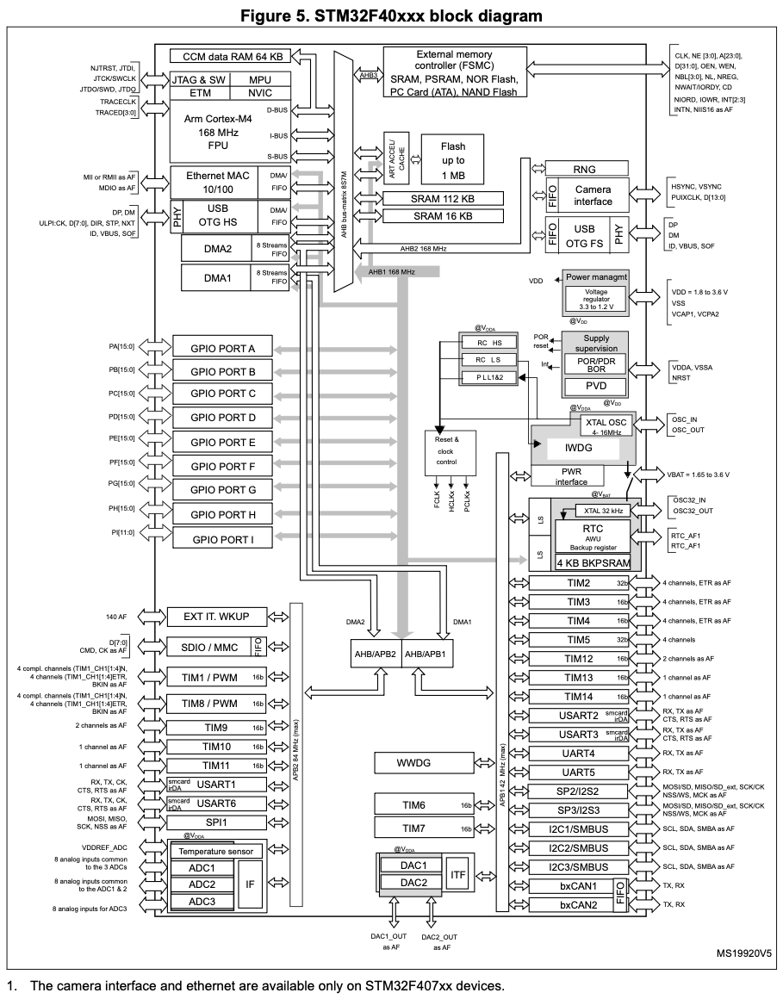
</p>

On the left side of the functional overview, there are three groups of blocks, in the middle the blocks start with `GPIO`, followed by PORT from `A` to `I`, except from port `I`, every port goes from `0` to `15`, to there are `16` ports. Our port of interest is port D, 12, so we found our General Purpose I/O register.

<p align="center">
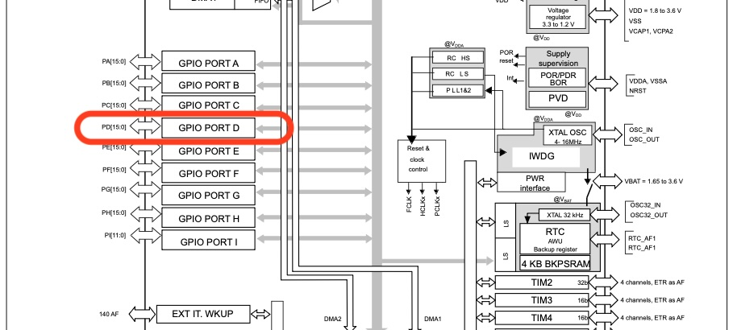
</p>


### What controls the enabling of this clock?

In the STM32F406VGT6 board, the peripheral which controls the clock is the **Reset and Clock Control** (RCC). We start with the Data Sheet, on page 20, section "3 Functional Overview", we can follow the path from `GPIOD` (`GPIO` port) to see which bus is carrying its signal. We see that the bus used is the **Advanced High-performance Bus 1**.

<p align="center">

</p>

Now we know that we need to look for the `RCC` of the `AHB1` peripheral. This information is in the Reference Manual, pages 243/244, section "7.3.10 RCC AHB1 peripheral clock enable register (`RCC_AHB1ENR`)". There we find the figure below and the correspondent bit.

<p align="center">

</p>

<p align="center">

</p>

**So the first task we have is to set bit 3 so the clock for GPIOD port is enabled.**

This first task was the hardest, everything was new to me, so I had to familiarize myself with several documents, how to navigate from one to the other, get minimally acquainted with the MCU diagram, and learn that some of the relationship between some components.

## Setting the GPIOD port to output mode

This is a good place to explain what I read in the Reference Manual, page 269, section "8.1 Introduction". 

> Each general-purpose I/O port has 
> * four 32-bit **configuration registers** (`GPIOx_MODER`, `GPIOx_OTYPER`, `GPIOx_OSPEEDR` and `GPIOx_PUPDR`), 
> * two 32-bit **data registers** (`GPIOx_IDR` and `GPIOx_ODR`), 
> * a 32-bit **set/reset register** (`GPIOx_BSRR`), 
> * a 32-bit **locking register** (`GPIOx_LCKR`) and 
> * two 32-bit **alternate function selection register** (`GPIOx_AFRH` and `GPIOx_AFRL`).

For our first example, we will need two regiters (we will choose between the last two for the writing):

| Register      | Full Name | Purpose     |
| :---:        |    :----:   |          :--- |
| `GPIOx_MODER`      | Mode register       | Selects input, output, alternate function, or analog mode.   |
| `GPIOx_ODR`   | Output data register        | Controls the logic level driven by each output pin.      |
| `GPIOx_BSRR` | Bit Set/Reset Register | Allows you to set or reset individual output bits without modifying the other bits. |

Let's see what the Reference Manual has on page 283, section "8.4.1 GPIO port mode register (GPIOx_MODER) (x = A..I/J/K)". From the title we see that x can vary from `A` to `K`, that includes `D`, which is our case. 

<p align="center">
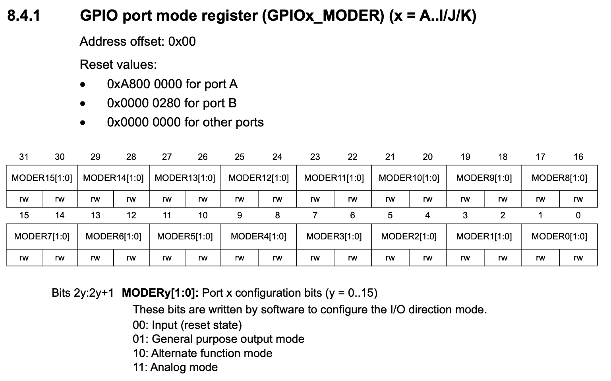
</p>

We can see at the bottom of the picture the modes in which we can configure `GPIOD`, since we want to output a value, we need to choose the General Purpose Output Mode. In the picture we can also see that bits 25 and 24 are responsible for `MODER12` (configuration of pin 12), so we will set bits 25 and 24 to `01`. Here is important to pay attention to the order, bit 25 will be reset and bit 24 will be set (25 will get `0`, 24 will get `1`), this is counter intuitive for me (since I'm doing this for the first time).

There is another thing that is relevant for this discussion. In this MCU, there are some components that can initiate bus transactions and there are others that can only respond to transactions. The former are called masters, the later slaves.

For instance, The Cortex-M4 CPU is a master, it initiates a read from memory or a write to a peripheral. On the other hand, a GPIO peripheral is a slave, it responds when the CPU accesses its registers.

The code we will write act on hardware registers, but underneath, the signals become bus transactions between masters and slaves.

## Setting the GPIOD port, pin 12 so the green LED is active

The last step is to set the signal to turn on the LED. In the Reference Manual, page 285, section "8.4.6 GPIO port output data register (GPIOx_ODR) (x = A..I/J/K)" we find the output data register diagram and we can see that bit 12 correspond to pin 12.

<p align="center">

</p>


### What do we have?

In this section we learned we will need to:

1. Enable the clock by setting bit `3` from the `RCC_AHB1ENR` register,
2. Set pin 12 to output mode from the `GPIOD_MODER` register, and
3. Set pin 12 of the `GPIOD_ODR` port.

These three actions are enough to turn on the green LED.

## Ready to write the code

In this section we will save the firmware that came from factory, so in case we want, we can put it back in place. For that we will need to download the STM32CubeProgrammer software. 

We will also create a project using the STM32CubeIDE software, we will write the program in this project, we will also need to setup some configurations and include de CMSIS device headers. Finally, we will push the binaries to the flash memory and run the first example.
 
### Saving the firmware before uploading a new one

The hardware came with a firmware (we can call it starting program) that I didn't want to lose, so I learned also how to read and back up from the flash memory.

We begin by downloading the [STM32CubeProgrammer](https://www.st.com/content/st_com/en/products/development-tools/software-development-tools/stm32-software-development-tools/stm32-programmers/stm32cubeprog.html). This software will allow us to read the flash memory from the board.

After installing and opening the program, we will see this screen:

<p align="center">

</p>

We need to choose ST-LINK, in the right hand side:

<p align="center">

</p>

After successfully connecting to the board, we will see that the program will display the Connected word on the top right corner. We will also see memory address content in the main panel, and a log in the bottom part of the window. 

<p align="center">

</p>

We can now inspect the RDP (readout Protection) option byte. In the lefthand side there is a menu, we can expand it or keep it only with icons. Pressing the "OB" icon, a new panel will be opened. There we see the RDP, we can read the available options in the description. We can confirm that the level is set to "AA", which is correspondent to Level 0, no protection.

<p align="center">
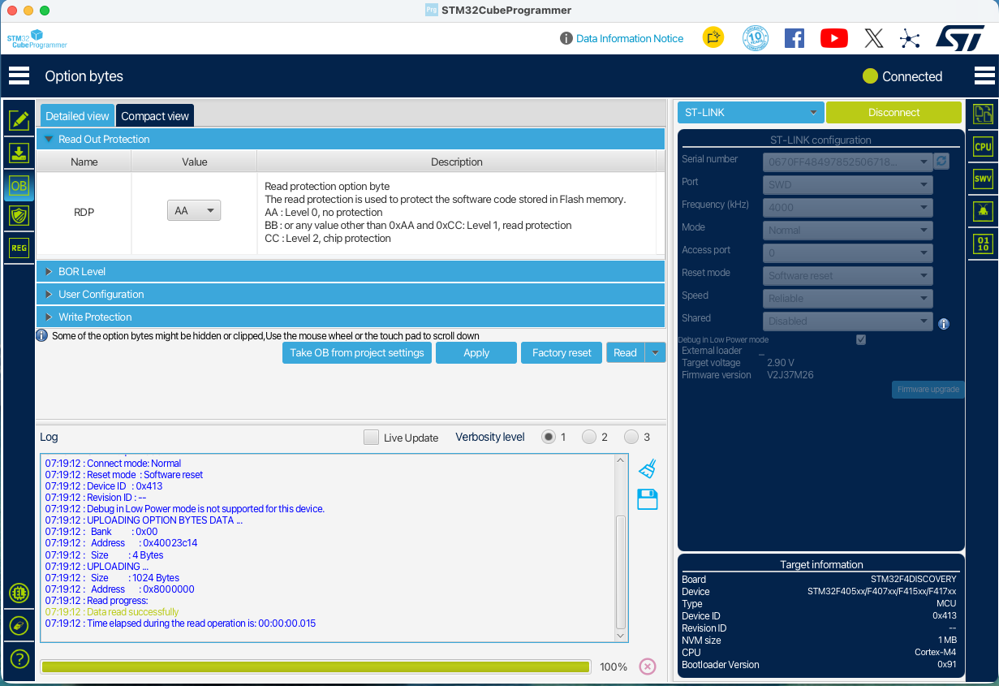
</p>

Now we need to choose the "Memory & File edition" tab in the left-hand panel. 

<p align="center">

</p>

We set the "Start Address" field to `0x0x08000000` and the "Size" field to `0x100000`, 1 MB. 

<p align="center">

</p>

We press read to load the memory into the screen and then, finally, we select the option "Save As..." to save the `.bin` file wherever we want. We check that the size is 1,048,576 bytes, which is 1 MB.

<p align="center">

</p>

This is the end of the saving procedure.


### Creating a project

(Since my first project is already created, I will build the second project, use the images here and then jump back to the first project images. )

To create a new project we fire up the STM32CubeIDE and then choose `File->Create/Import STM32 Project`. 

<p align="center">
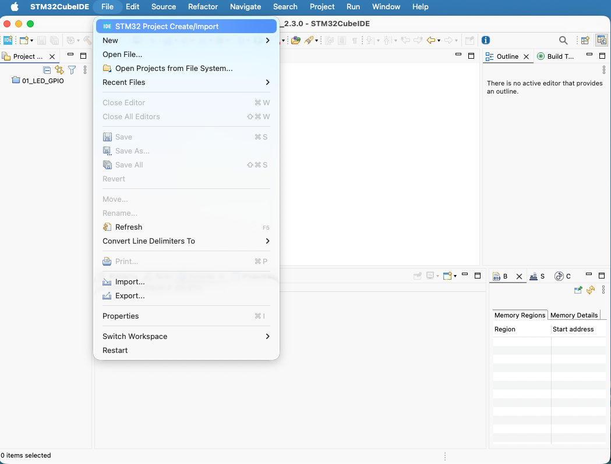
</p>

As a result, we will see this box:

<p align="center">
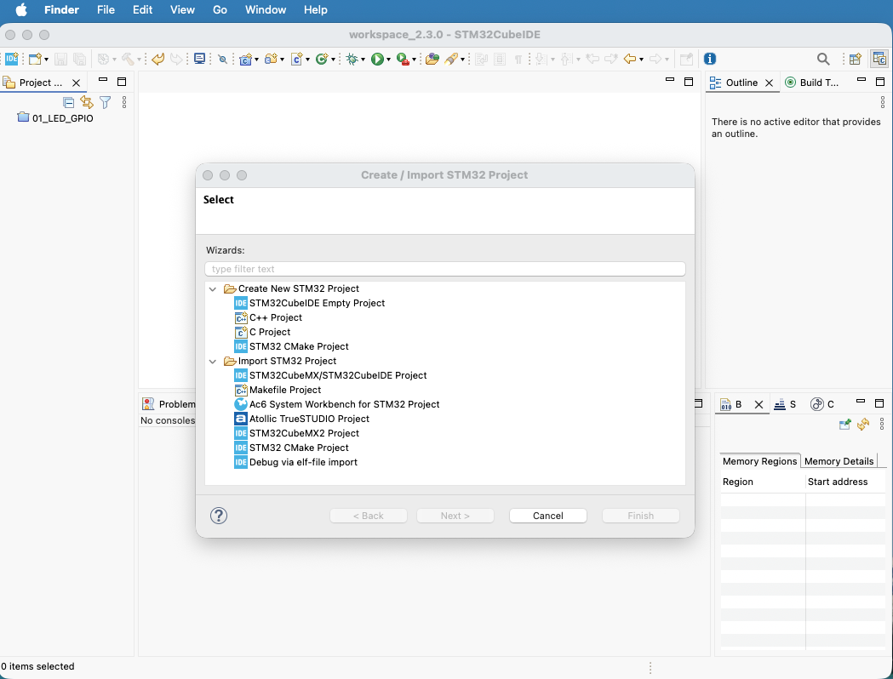
</p>

And we will choose the `STM32CubeIDE Empty Project` option, this will be our simples, closest to metal project:

<p align="center">

</p>

We filter our Board name (in my case `STM32F407VGT`) and choose `Series` and `Core`:

<p align="center">

</p>

We choose a project name, I will show the name for my second project, but we will work with the first in this post.

<p align="center">

</p>

The result is seen below. We can see that I opened the `main.c` file so we can see that there is a minimal biolerplate code added by the IDE.

<p align="center">

</p>

This minimal structure provided us with:

| Folder/file              | Purpose     |
| ----------------------   | :---------- |
| `Includes`               |   Header-file search paths used by the compiler      |
| `inc`                    | Your project's header files (`.h`) |
| `Src`                    | Your C source files (`.c`) |
| `Startup`                | Startup assembly code executed when the MCU resets |
| `STM32F407VGTx_FLASH.ld` | Linker script for placing code/data in Flash |
| `STM32F407VGTx_RAM.ld`   | Linker script for placing code/data in RAM |	

In the boilperplate code there are preporcessor checks. The furst, `__SOFT_FP__`, indicates that the compiler is using software floating-point support, the second, `__ARM_FP`, indicates the floating-point hardware capabilities target by the compiler.

If the first is not defined, the software floating-point mode is not indicated, if the second is defined, the compiler targets hardware floating-point instructions. If both are true, a warning is emitted.

In short, the warning reminds us that the startup code should configure the FPU before executing floating-point instructions.

### Finding the C structures

For this first project, and the next ones, where we want to work close to the metal, we will use the **Cortex Microcontroller Software Interface Standard (CMSIS)** headers. The definition of these is "*a software framework defined by Arm that provides a standardized interface for Cortex-M microcontrollers*". 

#### Downloading the correct firmware package and extracting it

Since my installation did not bring these headers, I have to download the official firmware package in [this](https://www.st.com/en/embedded-software/stm32cubef4.html) link. There, I chose the `STM32CubeF4` package. After extracting the package, we have this structure:

```
STM32Cube_FW_F4/
└── Drivers/
    └── CMSIS/
        ├── Include/
        └── Device/
            └── ST/
                └── STM32F4xx/
                    ├── Include/
                    └── Source/
```

#### Copying the relevant files

My project should have this structure:

```
01_LED_GPIO/
└── Drivers/
    └── CMSIS/
        ├── Include/
        └── Device/
            └── ST/
                └── STM32F4xx/
                    └── Include/
```

And I've copied the content of the `Include` folders:

1. `CMSIS/Include`: ARM Cortex-M core headers.
2. `CMSIS/Device/ST/STM32F4xx/Include`: STM32F4 device headers, including stm32f407xx.h.

#### Configuring STM32CubeIDE to use these headers:

Then I configured STM32CubeIDE to include these, first, I right clicked the project to select Properties.

<p align="center">

</p>

I navigated to C/C++ Build → Settings → MCU GCC Compiler → Include paths. I've added the these two paths: `../Drivers/CMSIS/Include` and `../Drivers/CMSIS/Device/ST/STM32F4xx/Include`.

<p align="center">
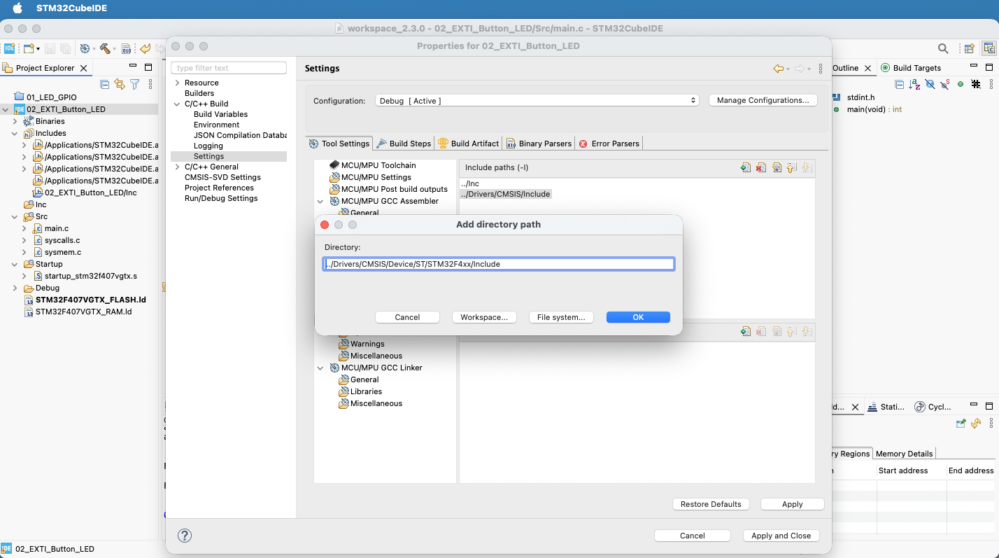
</p>

Clicked "Apply and Close":

<p align="center">

</p>

As a result, I see the newly added Includes in the project:

<p align="center">
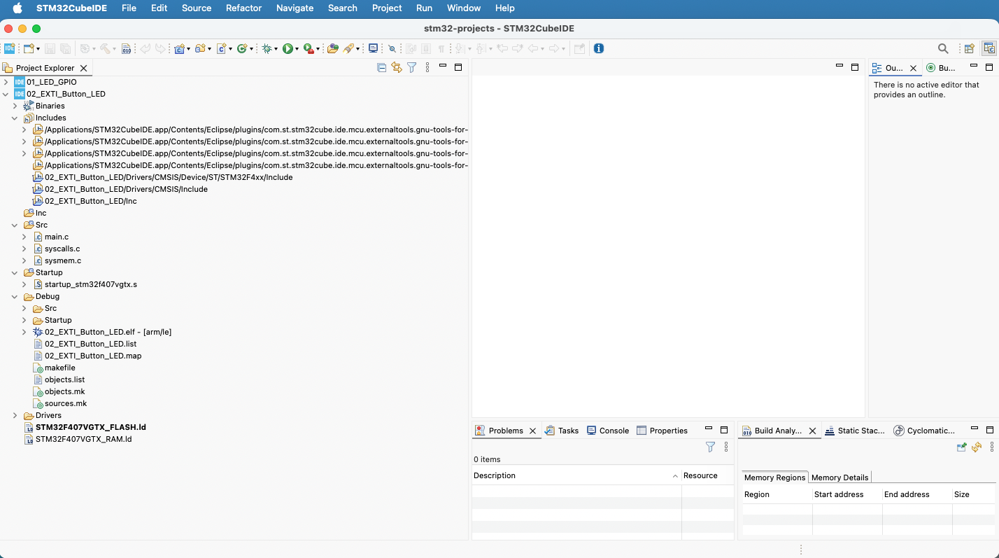
</p>

We now have the definitions for several hardware components for the board. We can see the included files under the `Drivers` folder:

<p align="center">
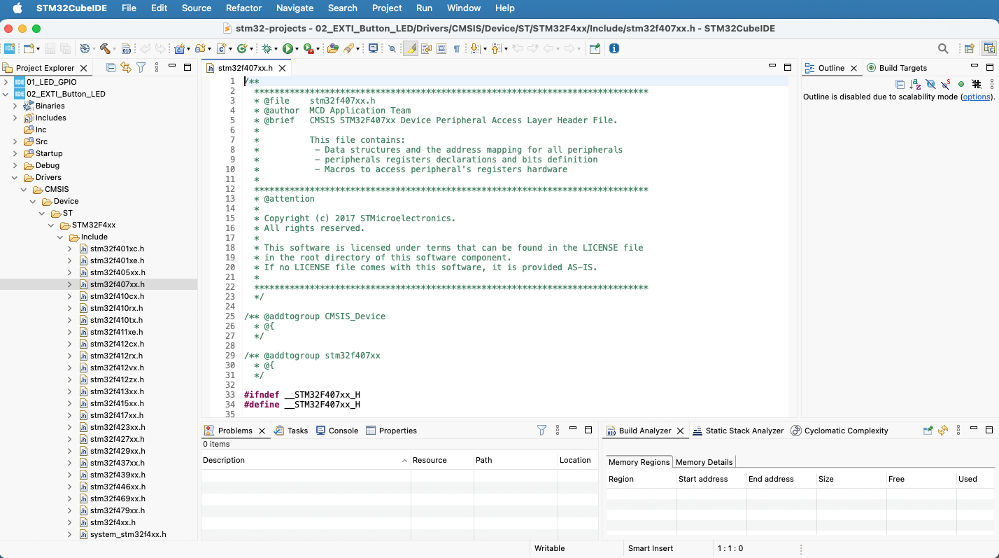
</p>

#### Inspecting the structures provided by the ST firmware

In this project I will use stm32f4xx.h, which is the STM32F4 device header provided by ST. It provides definitions for the STM32F4 peripherals, including:
- `GPIO` registers (`GPIOD` among others).
- `RCC` registers.
- Peripheral memory addresses.
- Register structures and bit definitions.

Let's inspect some parts of the code. Starting with `GPIO_TypeDef`:

```
/**
  * @brief General Purpose I/O
  */

typedef struct
{
  __IO uint32_t MODER;    /*!< GPIO port mode register,               Address offset: 0x00      */
  __IO uint32_t OTYPER;   /*!< GPIO port output type register,        Address offset: 0x04      */
  __IO uint32_t OSPEEDR;  /*!< GPIO port output speed register,       Address offset: 0x08      */
  __IO uint32_t PUPDR;    /*!< GPIO port pull-up/pull-down register,  Address offset: 0x0C      */
  __IO uint32_t IDR;      /*!< GPIO port input data register,         Address offset: 0x10      */
  __IO uint32_t ODR;      /*!< GPIO port output data register,        Address offset: 0x14      */
  __IO uint32_t BSRR;     /*!< GPIO port bit set/reset register,      Address offset: 0x18      */
  __IO uint32_t LCKR;     /*!< GPIO port configuration lock register, Address offset: 0x1C      */
  __IO uint32_t AFR[2];   /*!< GPIO alternate function registers,     Address offset: 0x20-0x24 */
} GPIO_TypeDef;
```

This structure represents the layout of a GPIO peripheral's registers in memory. Each of these registers occupies 4 bytes (`uint32_t`), as we saw in the Reference Manual.

We can see two registers that we will use. The first is `MODER`, which is used to configure the mode of the register, the second is `BSRR`, which we will use to set the value for the pin controlling the green LED. Here we start to see the connection between hardware and software!

Another interesting part of the code is this: 
```
#define GPIOD               ((GPIO_TypeDef *) GPIOD_BASE)
```

1. GPIOD_BASE is the base memory address of the GPIOD peripheral.
2. (GPIO_TypeDef *) casts that address to a pointer to GPIO_TypeDef.
3. GPIOD is therefore a pointer to a structure representing GPIOD's registers.

For each part of the `GPIOD` structure, there is a correspondence between each member and its memory address. 

```
GPIOD_MODER address = GPIOD_BASE + 0x00
GPIOD_ODR   address = GPIOD_BASE + 0x14
```

Since `MODER` has offset `0x00`, `GPIOD->MODER` access the structure `GPIOD_BASE` address. `ODR` has offset `0x14`, so `GPIOD->ODR` access `GPIOD_BASE` + `0x14`.

#### Including file `system_stm32f4xx.c` for System initialization and clock-related functions

For projects tinkering directly with registers, we will usually include this file in our `Src`, we simply need to copy it from `STM32Cube_FW_F4_V1.29.0/Drivers/CMSIS/Device/ST/STM32F4xx/Source/Templates`.

This file provides two important functions that run before `main()` runs:

1. `SystemInit()`
- Called during startup, before `main()`.
- Configures the MCU's initial system state.
- Configures the FPU when applicable.
- Sets up the clock system to its initial configuration.
- Configures the vector table location.

2. `SystemCoreClockUpdate()`
- Updates the global `SystemCoreClock` variable.
- Calculates the current core clock frequency based on the clock configuration registers.

#### Updating the device selection macro

I had a problem regarding the macro used to select the device, `stm32f4xx.h` expected `STM32F407xx`, so I included it in our preprocessor Defined symbols:

<p align="center">

</p>

### Writing the C code

After this gruesome preliminaries, we are finally ready to write some code!

#### Enabling the clock

First I need to enable the clock for `GPIOD`, this is done via the `RCC` struct, specifically, the 3rd bit from its `AHB1ENR` member. 

```
RCC->AHB1ENR |= (1U << 3);    /* Setting bit 3 to 1 */
```

This code sets the 3rd bit with `1`. The code is as explicitly as we can be, we grab a 1 bit, shift it 3 positions with the left shift operation, we `OR` it with the previous value, so independently of the value we had before, we now will have `1`.

The clock for `GPIOD` is now enabled.

#### Setting `GPIOD` to output mode

To do that we need to change register `GPIOD->MODER`, bits 25 and 24 are the ones responsible for pin 12. We want them to be in output mode, so these bits should be set to `01`.

```
GPIOD->MODER &= ~(3U << 24);    /* Clear bits 25 and 24 */
GPIOD->MODER |=  (1U << 24);    /* Set bit 24 to 1 */
```

The first line takes 3 in decimal, `11`, shift it 24 positions, landing in bits 25 and 24, inverts it, so every bit besides these two has `1`, and now it `AND` the previous value with this value. Every previous value `AND`ed with `1`produces the previous value, and for the two positions, anything `AND`ed with `0`, results in `0`. So, the first line clears these two bits.

The second line takes `1` and shift it to position 24, `OR` it with any previous value, generating `1` in this position.

The sum of these two actions is equivalent to setting bits 25:24 to `01`.

The mode for `GPIOD` pin 12 is now set to output mode.

#### Turning on the green LED 

Now we have two options to activate pin 12, we can either use `GPIOD->ORD` or `GPIOD->BSSR`. The first would require us to read, modify, and write, as we've done for the two previous registers. Let's try somethiing different, using `BSSR` we can write to the port without the need for the read-modify-write cycle.

```
GPIOD->BSRR = (1U << 12);    /* Set bit 12 to 1 */
```

Bit 12 is now set to 1.

#### Final adjustments

We cannot forget to add the `stm32f4xx.h` header to our code, and this is the code in its final form:

```
#include <stdint.h>
#include "stm32f4xx.h"

#if !defined(__SOFT_FP__) && defined(__ARM_FP)
  #warning "FPU is not initialized, but the project is compiling for an FPU. Please initialize the FPU before use."
#endif

/* To turn a LED on we need to:
 *    1. Enable its correspondent clock
 *    2. Set GPIOD to output mode through the MODER register */


int main(void)
{


	/* 1. Enabling GPIOD clock */
	RCC->AHB1ENR |= (1U << 3);

	/* 2. Setting GPIOD to output mode via MODER register */
	/* Getting 0b11, shifting 24 positions so it lands on bits 24 and 25, inverting it and ANDing it to clear the bits */
	GPIOD->MODER &= ~(3U << 24);
	/* Setting bits 24 and 25 to 0b01*/
	GPIOD->MODER |= (1U << 24);

	/* 3. Setting PD12 to 1, turning the green LED on */
	/* This is a set operation, so we don't need to AND it */
	GPIOD->BSRR = (1U << 12);

    /* Loop forever */
	for(;;);
}
```

To test it before sending to the firmware, we can build, using the "hammer" icon, when sending to the board, we will use the green triangle.

### Sending the new firmware

#### Setting up the ST-LINK Server 

Before sending the `elf` file, we need to setup the **ST-LINK Server**, downloading from [here](https://www.st.com/en/development-tools/st-link-server.html). This piece of software is the intermediary between the SMT32CubeIDE and the ST-LINK hardware present on the board. The server provides communication services for operations such as:

- Flashing your compiled firmware into the MCU.
- Starting and controlling debugging sessions.
- Reading and writing MCU memory and registers.
- Controlling execution (run, halt, reset, step).
- Providing access to the target through the ST-LINK interface.


#### Running
To send the compiled `elf` file, we connect the board using the `CN1` port, click the green triangle (Run), and the IDE download the file to the board.

After pressing the green triangle, I get this screen confirming if I want to update the firmware of the board to a newer firmaware, in other words, my new program.

<p align="center">
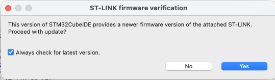
</p>

I confirm it and a new pop-up shows a list of devices to choose from.

<p align="center">

</p>

Since the fields "Version" and "Update to firmware" were empty, I've pressed the button "Open in update mode" and the interface correctly loaded the information.

<p align="center">

</p>

After I pressed the green triangle button, the program compiled correctly. 

<p align="center">

</p>

All good, so now we have the green LED working!


# Summary & Conclusion

This first project works as a foundational research for future projects. There was a lot to learn since everything was new:

1. How to connect to the computer,
2. Which software use to write code to later run on the board,
3. Which software to use to manage the flash memory with already written code,
4. Which registers to change in order to turn on a LED,
5. How to find components in the board,
6. How to find information in the documents,
7. How to import libraries and set up the IDE for programming,
8. How to build and, finally, 
9. how to send the code to the board.

## Steps to accomplish the first project

1. Learn about some basic parts of the board:
    - `RCC`
    - `GPIO`, including port mode register (`GPIOx_MODER`) and bit set/reset register (`GPIOxBSSR`) 

2. Programs used to communicate with the board:
    - `STM32CubeIDE` - Used to write code and send it to the board
    - `STM32CubeProgrammer` - Used to read the board's flash memory 
    - `ST-LINK Server` - Used to communicate with the onboard ST-LINK interface

3. How to include `CMSIS` headers to access the hardware with no abstraction and the correspondent implementation file (`.c`)


## Open subjects

There are a lot of open topics I need to further investigate in the future. Specifically, I want to understand the startup assembly code and the linker code. Although I have a general idea, I want to understand in details.

I want also to explore more the architecture of this board, this won't be done in this first post.
