# Introduction

Taking the first steps into embedded development is not as easy as taking the first steps in programming. Depending on the language and tools you choose, getting started with programming can be relatively straightforward: install a tool, and you're good to go. Of course, this depends heavily on your system and language of choice, but the initial setup can involve much less friction.

With embedded systems, this is not usually the case. There's an entire toolchain you need to have in place before you can see your first results. This post documents my first steps into this world. I'll describe the hardware I'm using and the steps I took to turn on the first LED on my board.

# Hardware

## Choosing my hardware

My hardware of choice is the **STM32F407VGT6** microcontroller and the **STM32F407G-DISC1** development board.

I wanted to experiment with **Arm® Cortex®-M** processors, work with peripherals, explore **bare-metal programming**, manipulate **hardware registers**, eventually explore Real-Time Operating Systems (RTOS), and develop using **C** and **C++**.

The board is manufactured by [STMicroelectronics](https://www.st.com/).

This is the [development board](https://estore.st.com/en/stm32f407g-disc1-cpn.html) I bought.

## What is an STM32?

STM32 is a family of microcontrollers developed by STMicroelectronics. The specific microcontroller on my board, the STM32F407VGT6, features a 32-bit **Arm® Cortex®-M4** core with a floating-point unit (FPU), **1 MByte of Flash memory** (where we store the firmware) and **192 KBytes of RAM**.

The development board also includes several peripherals and components:

* Eight LEDs, including four user LEDs.
* An omnidirectional digital microphone.
* A three-axis accelerometer (which measures acceleration along three axes and can detect movement, changes in orientation, tilting and vibration).
* A user button (whose purpose we can configure) and a reset push button.
* An audio DAC (Digital-to-Analog Converter, which converts digital audio signals into analog signals) with an integrated Class D speaker driver.
* A USB Micro-AB connector supporting USB OTG host/device operation (allowing us to connect the board to a computer or USB peripherals).
* A stereo audio output jack.
* Extension headers (which allow us to connect the microcontroller's I/O pins to external equipment).

The board also offers flexible power-supply options and an on-board ST-LINK/V2-A interface, which allows us to program and debug the microcontroller while connected to a computer. ST also provides software libraries and development tools to support development with the board.

Something I didn't know, but found interesting, is that the **ST-LINK** is actually **a separate microcontroller-based debugging and programming device** integrated into the Discovery board. It has its own STM32F103 microcontroller, separate from the STM32F407 that runs our application.

It's also interesting to note that the programs we write for the microcontroller are its firmware, which is stored in its Flash memory.

<p align="center">

</p>

# Goal description

The first project I wanted to build is the equivalent of a **`"Hello World!"`** program: simply turning on an LED. It's the simplest way I could think of to interact with the outside world.

This small project turned out to be a much bigger challenge than I expected. As we'll see, it required me to read several technical documents, understand some aspects of microcontroller architecture, and explore the development tools provided by the manufacturer.

Through my research, I discovered that I had to perform **three steps** to turn on an LED:

1. Enable the clock for the General Purpose I/O (GPIO) port to which the LED's pin belongs.
2. Configure the GPIO pin to operate as an output.
3. Set the output state of the GPIO pin connected to the LED.

In this context, **GPIO (General-Purpose Input/Output)** refers to a type of peripheral responsible for controlling the microcontroller's general-purpose input/output pins.

On the STM32, these pins are organized into several GPIO ports, each containing multiple pins. Some of these pins are connected to specific components on the development board, and we'll use one of them to control the green LED.

The GPIO pins are controlled through memory-mapped registers, commonly referred to as GPIO registers. Different registers serve different purposes: some configure the operating mode of each pin, while others control output signals or read input signals.

By going through these steps, I'll learn about important topics such as peripheral clock configuration, GPIO pin modes, memory-mapped registers, and identifying components and their connections on the development board.


## Enabling the clock for the General Purpose I/O (GPIO) port correspondent to the LED

To accomplish this first step, I need to identify the LED, find the GPIO pin that controls it, understand which registers control that pin, and determine how to enable the clock for the corresponding GPIO port.

### Why do I need a clock, and why do I need to enable it?

In digital systems, components need a way to exchange information. A bus is a set of signal lines that carries data, addresses, and control signals between components. In synchronous digital circuits, a clock provides a timing reference that allows these components to coordinate their operations. At specific points in the clock cycle, usually on a rising or falling edge, components sample input signals and update their internal state.

In this particular microcontroller, the clocks to many peripherals can be enabled or disabled to save energy. This is especially important in embedded systems, where power consumption can be a significant constraint. By disabling the clocks of peripherals that are not being used, we can reduce the microcontroller's power consumption.

This is why we need to enable the clock for the peripherals we want to use. In our case, we'll enable the clock for the GPIO port connected to the LED.

### Which pin corresponds to the green LED?

I chose to turn on the green LED, so I had to find the pin responsible for controlling it. The [User Manual - UM1472](https://www.st.com/resource/en/user_manual/um1472-discovery-kit-with-stm32f407vg-mcu-stmicroelectronics), on page 21, section 7.5, states:

> *"User LD4: The green LED is a user LED connected to the I/O PD12 of the STM32F407VGT6"*

According to this naming convention, `PD12` refers to pin 12 of GPIO port D. This is the first piece of our puzzle. Now I need to find out which GPIO registers control this pin.


### How is GPIO port D connected to the microcontroller?

The [STM32F407VG Datasheet](https://www.st.com/resource/en/datasheet/stm32f407vg.pdf), on page 20, in section 3, "Functional Overview", contains the following diagram:

<p align="center">

</p>

On the left side of the diagram, we can see nine GPIO port blocks, named from GPIO PORT A to GPIO PORT I. Ports A through H have 16 pins each, numbered from 0 to 15. Port I has 12 pins, numbered from 0 to 11.

Our pin of interest, `PD12`, belongs to GPIO port D. The diagram also shows that the GPIO ports are connected to the `AHB1` bus.

This is another piece of our puzzle: we now know which GPIO port controls the LED and where that peripheral fits into the microcontroller's bus architecture.

<p align="center">

</p>


### What controls the enabling of this clock?

In the `STM32F407VGT6` microcontroller, the peripheral responsible for controlling the clocks is the **Reset and Clock Control (`RCC`)**.

We start with the datasheet again, on page 20, section 3, "Functional Overview". By following the connection from `GPIOD` (GPIO port D), we can see that it is connected to the **Advanced High-performance Bus 1 (`AHB1`)**.

<p align="center">
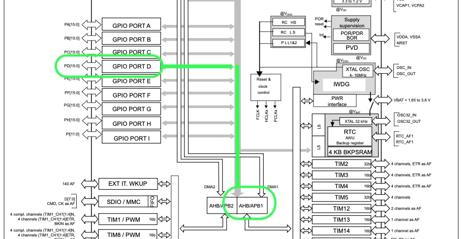
</p>

Now we know that we need to look for the RCC register responsible for enabling the clocks of peripherals connected to the AHB1 bus.

This information is in the Reference Manual (RM0090), on pages 243–244, section 7.3.10, "RCC AHB1 peripheral clock enable register (`RCC_AHB1ENR`)". There we find the register layout and the corresponding enable bit for each peripheral.

<p align="center">
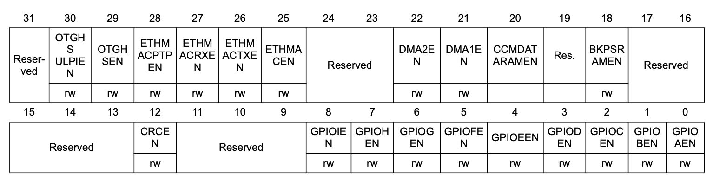
</p>

<p align="center">
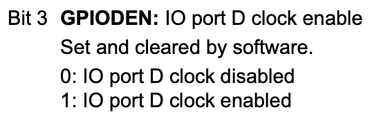
</p>

**So, the first task is to set bit 3 (`GPIODEN`) to enable the clock for GPIO port D.**

This first task was the hardest. Everything was new to me, so I had to familiarize myself with several documents, learn how to navigate between them, get a basic understanding of the MCU's block diagram, and understand how some of its components are related.


## Setting pin `PD12` to output mode

This is a good place to explain what I read in the Reference Manual, on page 269, section 8.1, "Introduction".

> Each general-purpose I/O port has
> - four 32-bit **configuration registers** (`GPIOx_MODER`, `GPIOx_OTYPER`, `GPIOx_OSPEEDR` and `GPIOx_PUPDR`),
> - two 32-bit **data registers** (`GPIOx_IDR` and `GPIOx_ODR`),
> - a 32-bit **set/reset register** (`GPIOx_BSRR`),
> - a 32-bit **locking register** (`GPIOx_LCKR`) and
> - two 32-bit **alternate function selection registers** (`GPIOx_AFRH` and `GPIOx_AFRL`).

For our first example, we will need two registers: `GPIOx_MODER` and either `GPIOx_ODR` or `GPIOx_BSRR` to control the output.

| Register | Full Name | Purpose |
|:---:|:---:|:---|
| `GPIOx_MODER` | Mode register | Selects input, output, alternate function, or analog mode. |
| `GPIOx_ODR` | Output data register | Controls the logic level driven by each output pin. |
| `GPIOx_BSRR` | Bit Set/Reset register | Allows individual output bits to be set or reset without modifying the other bits. |

Let's see what the Reference Manual has on page 283, section 8.4.1, "GPIO port mode register (`GPIOx_MODER`) (x = A..I/J/K)". From the title, we can see that `x` is a placeholder for the GPIO port letter. For our microcontroller, this includes `D`, which is the port we're interested in.

<p align="center">

</p>

At the bottom of the picture, we can see the different modes in which we can configure each GPIO pin. Since we want to output a value, we need to select General-purpose output mode.

The diagram also shows that bits 25 and 24 are responsible for `MODER12`, which configures pin 12. Therefore, we need to set these two bits to `01`.

Here it is important to pay attention to the order: bit 25 will be reset and bit 24 will be set (bit 25 will become `0`, and bit 24 will become `1`). This is counterintuitive to me, since I'm doing this for the first time.

The reason bit 25 comes first is that it represents the most significant bit (bit 1) of the two-bit field, while bit 24 represents the least significant bit (bit 0).

There is another concept that is relevant to this discussion. In this MCU, some components can initiate bus transactions, while others can only respond to them. The former are called **masters**, and the latter are called **slaves**.

For instance, the Cortex-M4 CPU is a master: it initiates reads from memory or writes to peripherals. On the other hand, a GPIO peripheral is a slave: it responds when the CPU accesses its registers.

The code we write operates on hardware registers, but underneath, each register access results in bus transactions between masters and slaves.


## Setting pin 12 of GPIOD to turn on the green LED

The last step is to set the output signal that turns on the LED. In the Reference Manual, on page 285, section 8.4.6, "GPIO port output data register (`GPIOx_ODR`) (x = A..I/J/K)", we find the output data register diagram. It shows that bit 12 controls pin 12. On this board, setting `ODR` bit 12 to `1` turns on the green LED, because it is active-high.

<p align="center">
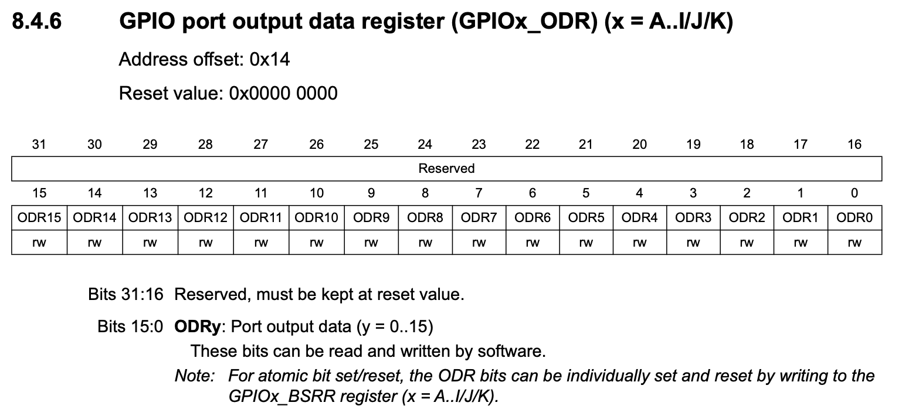
</p>


## What do we have?

In this section, we learned that we need to:

1. Enable the clock for `GPIOD` by setting bit 3 (`GPIODEN`) in the `RCC_AHB1ENR` register.
2. Set pin 12 to output mode using the `GPIOD_MODER` register.
3. Set bit 12 in the `GPIOD_ODR` register to turn on the LED.

These three actions are enough to turn on the green LED.

# Development Environment

## Connection to the computer (hardware setup)

Before creating a project, I wanted to power on the board and check that everything was working. My plan was to connect it to my computer and verify that the board was functioning correctly. That's when I discovered I was missing a cable to connect it to my computer. I had to stop everything and find somewhere to buy one.

Since I use a Mac with an M1 processor, I needed a cable with a USB Type-C connector on one end and a Mini-B connector on the other. The User Manual (UM1472), on page 11, section 6.1, "Getting started", item 2, states:

> "Connect the `STM32F4DISCOVERY` board to a PC with a USB Type-A or USB Type-C® to Mini-B cable through USB connector `CN1` to power the board. Red LED `LD2` (PWR) then lights up."

**CN1** is the USB connector used to connect the board's embedded `ST-LINK/V2-A` to the computer. Through this connection, the board receives power, and the ST-LINK provides the programming and debugging interface.

When I first connected the board to my computer, four LEDs started blinking, as described in the same section of the user manual, item 3:

> "Four LEDs between buttons `B1` and `B2` are blinking."

To double-check that my Mac was detecting the board, and not just that the board was receiving power, I opened System Information, selected USB, and looked for **`STMicroelectronics ST-LINK`**. This confirmed that my computer was detecting the board's ST-LINK interface.


## Introduction to STM32CubeIDE (development tool)

The tool I'm using to write code, build the firmware, debug it, and program the board is [STM32CubeIDE](https://www.st.com/content/st_com/en/products/development-tools/software-development-tools/stm32-software-development-tools/stm32-ides/stm32cubeide.html). It integrates the Arm GNU Toolchain, the GDB debugger, and ST-LINK debugging support.

<p align="center">

</p>


## Choosing C and CMSIS (programming approach)

This microcontroller can be programmed in either C or C++. Besides choosing a language, I also need to decide which level of abstraction to use when accessing its peripherals. STM32 provides two driver libraries for this purpose: `HAL` (Hardware Abstraction Layer) and `LL` (Low-Layer) drivers. As their names suggest, HAL provides a higher level of abstraction, hiding much of the hardware complexity, while LL provides a thinner layer of abstraction and gives us more direct control over the peripherals.

Since I want to explore the MCU in depth, I've chosen to start with C and use the register definitions provided by **Cortex Microcontroller Software Interface Standard (CMSIS)**. This will allow me to explore the actual hardware registers and manipulate their contents down to the bit! My approach is to work directly with the registers, without relying on `HAL` or `LL` drivers.

# Ready to write the code

In this section, we'll save a copy of the firmware that came preloaded on the board, so we can restore it later if needed. To do this, we'll need to download and install STM32CubeProgrammer.

We'll also create a project using STM32CubeIDE, write our program, configure the project, and include the CMSIS device headers. Finally, we'll program the microcontroller's Flash memory with our firmware and run our first example.

## Saving the firmware before programming the board

The board came with firmware preloaded, which I didn't want to lose. I therefore decided to learn how to read and back up the contents of its Flash memory.

We begin by downloading the [STM32CubeProgrammer](https://www.st.com/content/st_com/en/products/development-tools/software-development-tools/stm32-software-development-tools/stm32-programmers/stm32cubeprog.html). This software allows us to read the Flash memory contents from the board.

After installing and opening the program, we will see the following screen:

<p align="center">
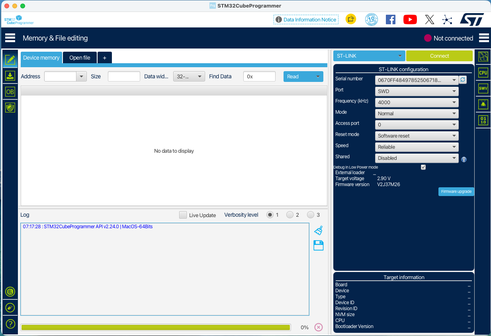
</p>

We need to select ST-LINK on the right-hand side:

<p align="center">
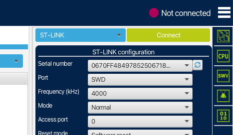
</p>

After successfully connecting to the board, the program displays the word "Connected" in the top-right corner. We will also see memory contents in the main panel and a log at the bottom of the window.

<p align="center">

</p>

We can now inspect the RDP (Readout Protection) option byte. On the left-hand side, there is a menu that can be expanded or displayed using icons only. By clicking the "OB" icon, a new panel opens. There we can find the RDP setting and read about the available options in its description. We can confirm that its value is set to "AA", which corresponds to Level 0 (no readout protection).

<p align="center">

</p>

Next, we select the "Memory & File edition" tab in the left-hand panel.

<p align="center">
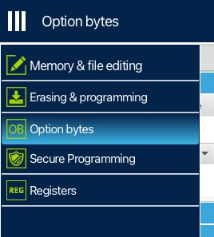
</p>

We set the "Start Address" field to `0x08000000` and the "Size" field to `0x100000`, corresponding to 1 MB.

<p align="center">
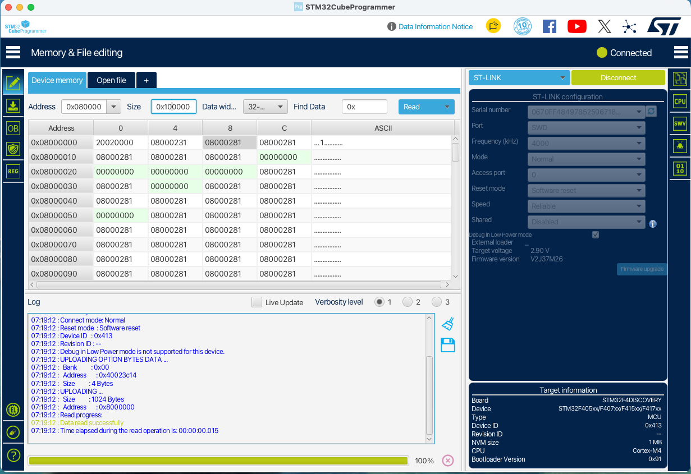
</p>

We click "Read" to load the memory contents into the main panel. Finally, we select "Save As..." to save the contents as a `.bin` file wherever we want. We can check that the resulting file is 1,048,576 bytes (1 MB).

<p align="center">
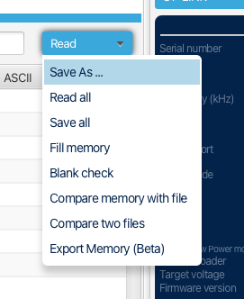
</p>

This completes the backup procedure.


## Creating a project

To create a new project, we open STM32CubeIDE and select `File → Create/Import STM32 Project`.

<p align="center">

</p>

We will then see the following dialog:

<p align="center">

</p>

We choose the `STM32CubeIDE Empty Project` option. This gives us a minimal project, without the HAL or LL initialization code:

<p align="center">
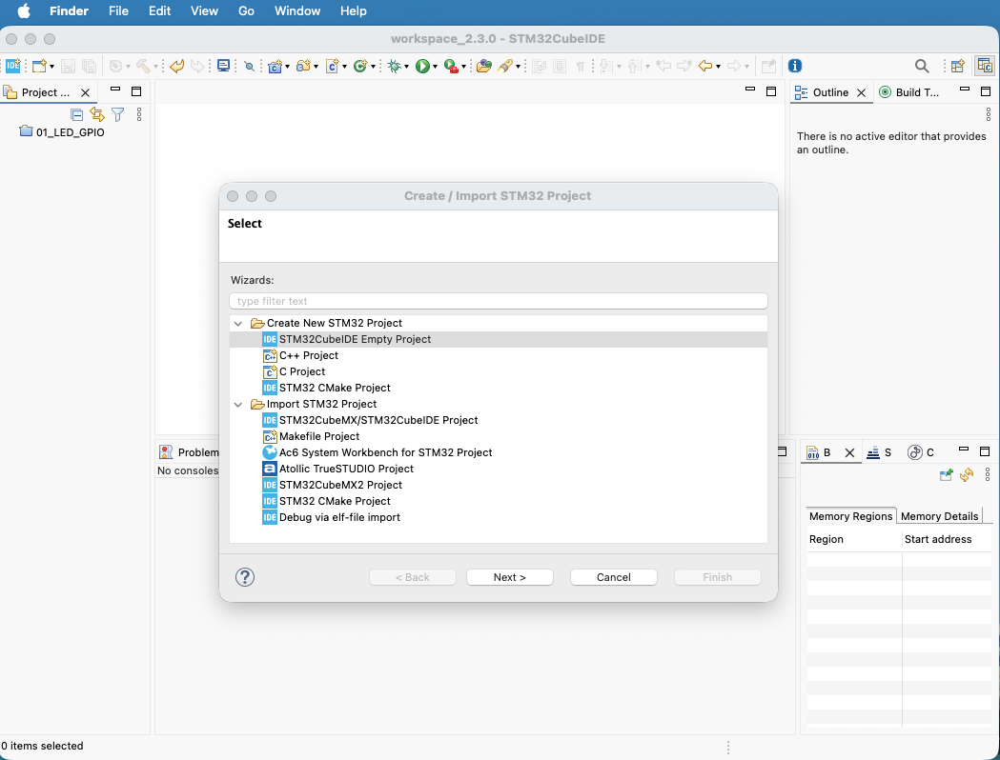
</p>

We search for the MCU using its part number (in my case, `STM32F407VGT6`), and select the corresponding series and core:

<p align="center">
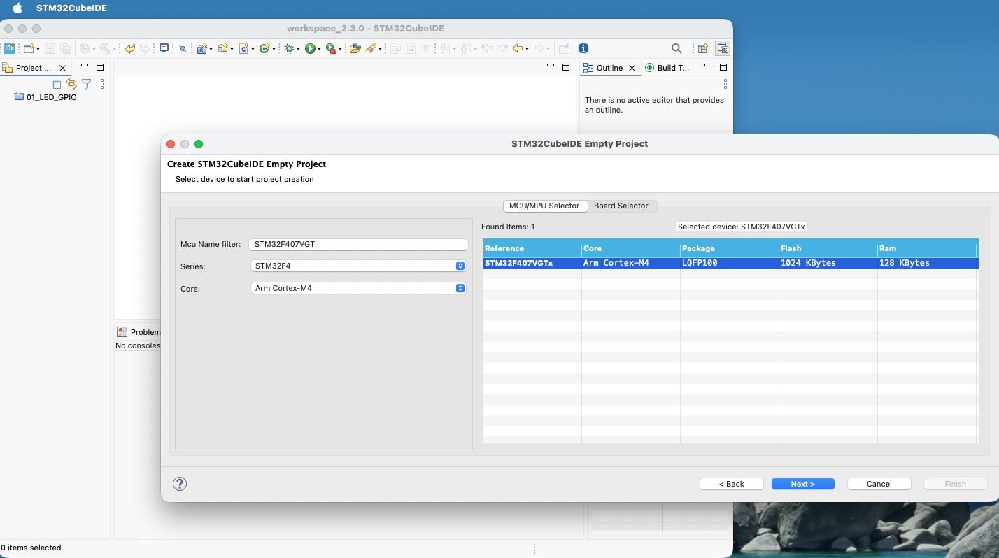
</p>

Next, we choose a project name. I'll show the name I used for my second project, although we'll work with the first project in this post.

<p align="center">
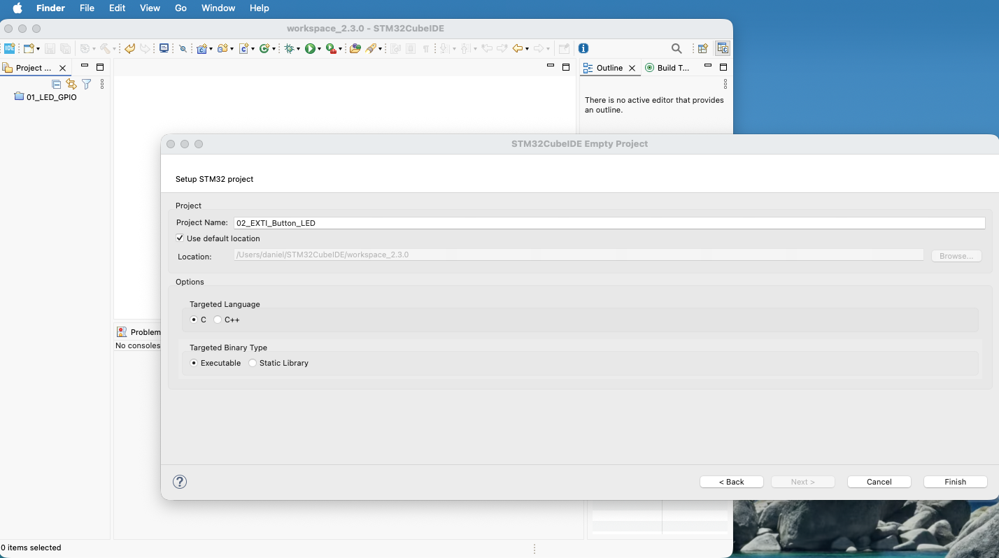
</p>

The result is shown below. I've opened `main.c` so we can see the minimal boilerplate code generated by the IDE.

<p align="center">
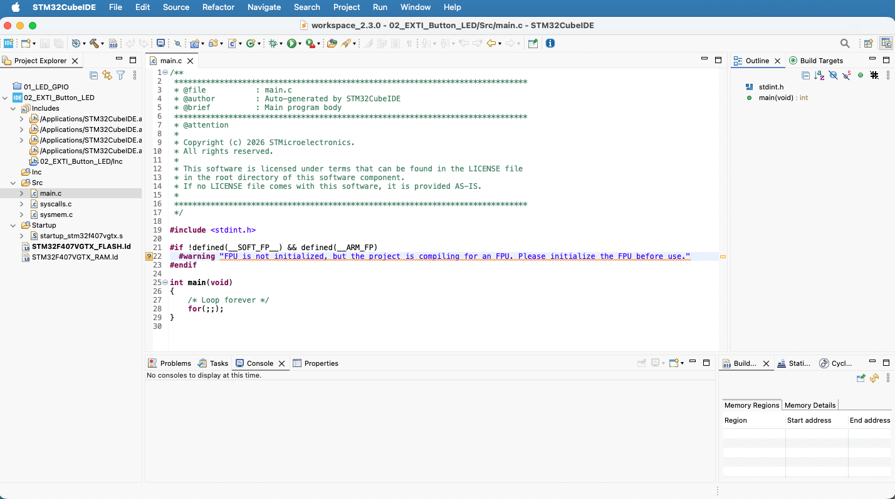
</p>

This project structure provides us with the following folders and files:

| Folder/file | Purpose |
|---|---|
| `Includes` | IDE container showing the header-file search paths used by the compiler. |
| `Inc` | Header files (`.h`) belonging to the project. |
| `Src` | C source files (`.c`) belonging to the project. |
| `Startup` | Startup assembly code executed when the MCU resets. |
| `STM32F407VGTx_FLASH.ld` | Linker script defining how code and data are placed in Flash memory. |
| `STM32F407VGTx_RAM.ld` | Linker script defining how code and data are placed in RAM. |


In the boilerplate code, there is also a preprocessor check involving `__SOFT_FP__` and `__ARM_FP`. The first indicates that the project is configured to use software floating-point support, while the second indicates that the compiler targets hardware floating-point instructions.

The condition checks whether `__SOFT_FP__` is not defined while `__ARM_FP` is defined. If this is the case, a warning is emitted.

In short, the warning reminds us that the FPU must be initialized before executing floating-point instructions when the project is configured to use the hardware FPU.

## Finding the C structures

For this first project, and the ones that follow, we'll use the CMSIS device headers to access the microcontroller's hardware registers through C structures.

### Downloading the correct firmware package and extracting it

Since my installation did not include these headers, I need to download the official firmware package from the [STM32CubeF4 page](https://www.st.com/en/embedded-software/stm32cubef4.html). On that page, I select the `STM32CubeF4` package.

After downloading and extracting the package, we get the following directory structure:

```
STM32Cube_FW_F4/
└── Drivers/
    └── CMSIS/
        ├── Include/
        └── Device/
            └── ST/
                └── STM32F4xx/
                    ├── Include/
                    └── Source/
```

### Copying the relevant files

My project should have the following directory structure:

```
01_LED_GPIO/
└── Drivers/
    └── CMSIS/
        ├── Include/
        └── Device/
            └── ST/
                └── STM32F4xx/
                    └── Include/
```

I copied the contents of the two `Include` directories:

1. `CMSIS/Include`: Arm Cortex-M core headers.
2. `CMSIS/Device/ST/STM32F4xx/Include`: STM32F4 device headers, including `stm32f407xx.h`.

### Configuring STM32CubeIDE to use these headers

Next, I configured STM32CubeIDE to use these headers. First, I right-clicked the project and selected **Properties**.

<p align="center">
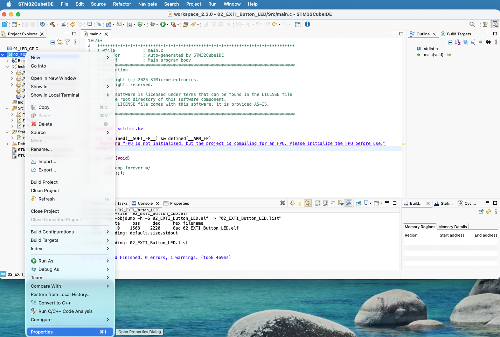
</p>

I navigated to **C/C++ Build → Settings → MCU GCC Compiler → Include paths** and added the following two paths:

- `../Drivers/CMSIS/Include`
- `../Drivers/CMSIS/Device/ST/STM32F4xx/Include`

<p align="center">

</p>

I then clicked **Apply and Close**.

<p align="center">
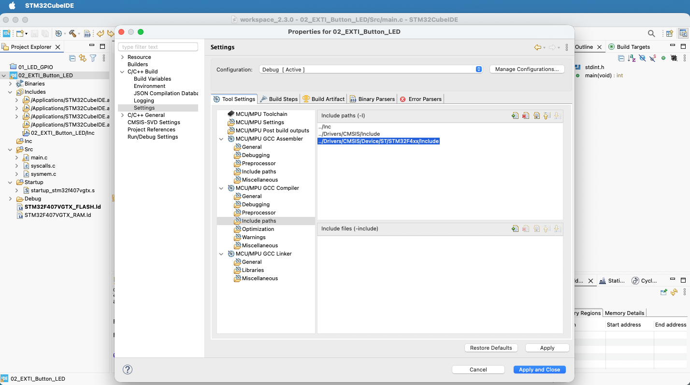
</p>

The newly added include paths are now visible in the project:

<p align="center">

</p>

We now have access to the definitions of several hardware components of the microcontroller. We can browse the included header files under the `Drivers` folder:

<p align="center">

</p>

### Inspecting the structures provided by the ST firmware

In this project, I will use `stm32f4xx.h`, which is the STM32F4 device header provided by ST. It provides definitions for the STM32F4 peripherals, including:

- `GPIO` registers (`GPIOD` among others).
- `RCC` registers.
- Peripheral memory addresses.
- Register structures and bit definitions.

`stm32f4xx.h` is the common STM32F4 device header. It uses the selected device macro to include the appropriate device-specific header, such as `stm32f407xx.h`. That's where you'll find the STM32F407-specific definitions.

Let's inspect some parts of the code, starting with `GPIO_TypeDef`:

```c
/**
 * @brief General Purpose I/O
 */

typedef struct
{
  __IO uint32_t MODER;    /*!< GPIO port mode register,               Address offset: 0x00 */
  __IO uint32_t OTYPER;   /*!< GPIO port output type register,        Address offset: 0x04 */
  __IO uint32_t OSPEEDR;  /*!< GPIO port output speed register,       Address offset: 0x08 */
  __IO uint32_t PUPDR;    /*!< GPIO port pull-up/pull-down register,  Address offset: 0x0C */
  __IO uint32_t IDR;      /*!< GPIO port input data register,         Address offset: 0x10 */
  __IO uint32_t ODR;      /*!< GPIO port output data register,        Address offset: 0x14 */
  __IO uint32_t BSRR;     /*!< GPIO port bit set/reset register,      Address offset: 0x18 */
  __IO uint32_t LCKR;     /*!< GPIO port configuration lock register, Address offset: 0x1C */
  __IO uint32_t AFR[2];   /*!< GPIO alternate function registers,     Address offset: 0x20-0x24 */
} GPIO_TypeDef;
```

Every member is declared using `__IO`. This is a CMSIS macro that expands to the C `volatile` qualifier.

The `volatile` qualifier tells the compiler that the value may change independently of the program's normal execution. This is particularly important when working with hardware registers, since their values can change as a result of external signals or hardware operations. It also ensures that accesses to these registers are not optimized away or replaced by assumptions that their values haven't changed.

This structure represents the layout of a GPIO peripheral's registers in memory. Each of these registers occupies 4 bytes (`uint32_t`), as we saw in the Reference Manual.

We can see the registers we'll use in this project. The first is `MODER`, which configures the operating mode of each GPIO pin. The second is `BSRR`, which we'll use to set the output state of the pin connected to the green LED.

Here we start to see the connection between hardware and software!

Another interesting part of the code is this:

```c
#define GPIOD ((GPIO_TypeDef *) GPIOD_BASE)
```

1. `GPIOD_BASE` is the base memory address of the GPIOD peripheral.
2. `(GPIO_TypeDef *)` casts that address to a pointer to `GPIO_TypeDef`.
3. `GPIOD` is therefore a pointer to a structure representing GPIOD's registers.

For each member of the `GPIOD` structure, there is a corresponding memory address, determined by its offset from the peripheral's base address.

```text
GPIOD->MODER address = GPIOD_BASE + 0x00
GPIOD->BSRR  address = GPIOD_BASE + 0x18
```

The important thing to understand is that the compiler uses the structure's layout to calculate the address of each member.

When we access `GPIOD->MODER`, the compiler takes the address stored in `GPIOD` and adds the offset of the `MODER` member (`0x00`). Similarly, accessing `GPIOD->BSRR` adds the offset of the `BSRR` member (`0x18`).

The resulting memory addresses correspond directly to the hardware registers. Reading from or writing to these addresses therefore allows our program to interact with the actual GPIO peripheral.


### Including `system_stm32f4xx.c` for system initialization and clock-related functions

For this project, we also need to include `system_stm32f4xx.c` in the `Src` directory. We can find it in:

`STM32Cube_FW_F4_V1.29.0/Drivers/CMSIS/Device/ST/STM32F4xx/Source/Templates`

This file provides some important system-related functions:

- `SystemInit()`: Called automatically during startup, before `main()`. It performs the initial system setup.
- `SystemCoreClockUpdate()`: Updates the `SystemCoreClock` variable to reflect the current HCLK frequency. It can be called when we need to refresh this information after changing the clock configuration.

We'll encounter these functions again as we explore the microcontroller and its clock system.

### Updating the device selection macro

I encountered a problem with the device selection macro. The `stm32f4xx.h` header expects the `STM32F407xx` macro to be defined, so I added it to the project's preprocessor defined symbols:

<p align="center">
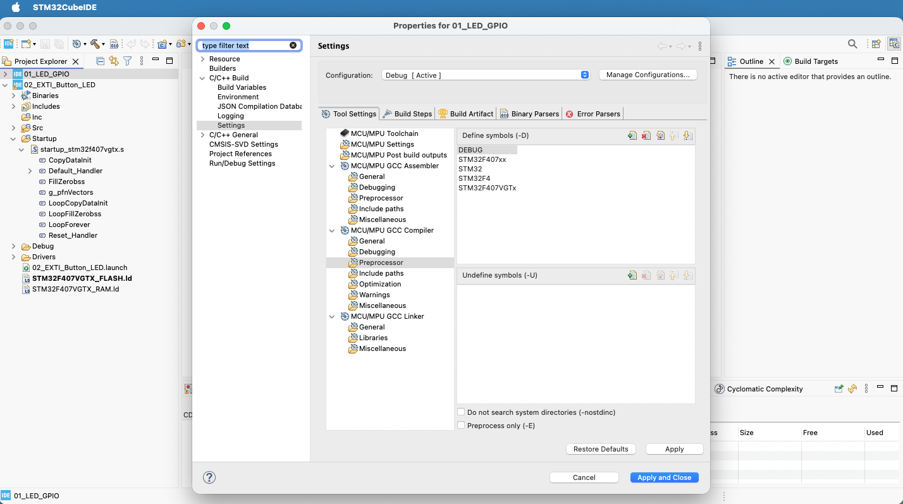
</p>


## Writing the C code

After all this preparation, we're finally ready to write some code!

### Enabling the clock

First, I need to enable the clock for `GPIOD`. This is done via the `RCC` structure, specifically by setting bit 3 of its `AHB1ENR` member.

```c
RCC->AHB1ENR |= (1U << 3);  /* Setting bit 3 to 1 */
```

This code sets bit 3 to 1. We start with the value `1U`, shift it three positions to the left using the left-shift operator, and then perform a bitwise `OR` with the previous register value. Regardless of the previous value of bit 3, it will now be `1`, while all other bits remain unchanged.

The clock for `GPIOD` is now enabled.


The first line takes 3 in decimal, `11`, shift it 24 positions, landing in bits 25 and 24, inverts it, so every bit besides these two has `1`, and now it `AND` the previous value with this value. Every previous value `AND`ed with `1`produces the previous value, and for the two positions, anything `AND`ed with `0`, results in `0`. So, the first line clears these two bits.

The second line takes `1` and shift it to position 24, `OR` it with any previous value, generating `1` in this position.

The sum of these two actions is equivalent to setting bits 25:24 to `01`.

The mode for `GPIOD` pin 12 is now set to output mode.


### Setting `GPIOD` to output mode

Second, we need to change the `GPIOD->MODER` register. Bits 25 and 24 control the mode of pin 12. We want to configure it as a general-purpose output, so these bits must be set to 01.

```c
GPIOD->MODER &= ~(3U << 24);  /* Clear bits 25 and 24 */
GPIOD->MODER |=  (1U << 24);  /* Set bit 24 to 1 */
```

Let's break this down. The first line takes the value `3U`, which is `11` in binary, and shifts it 24 positions to the left. This places `11` in bits 25 and 24. We then invert the result using the bitwise `NOT` operator (`~`), producing a mask with `0` in those two positions and `1` everywhere else.

Next, we perform a bitwise `AND` with the previous register value. Any bit `AND`ed with `1` retains its previous value, while any bit `AND`ed with `0` becomes `0`. Therefore, this operation clears bits 25 and 24 without affecting the other bits.

The second line shifts `1U` 24 positions to the left and performs a bitwise `OR` with the register value. This sets bit 24 to `1`.

Together, these two operations set bits 25:24 to `01`.

The mode of `PD12` is now set to output mode.


### Turning on the green LED

Finally, we have two options for setting the output state of `PD12`: we can use either `GPIOD->ODR` or `GPIOD->BSRR`. The first requires a read-modify-write operation, as we've done with the two previous registers. Let's try something different. Using `BSRR`, we can write directly to the register without having to read its previous value.

```c
GPIOD->BSRR = (1U << 12);  /* Set bit 12 to 1 */
```

Bit 12 is now set to 1, turning on the green LED.

### Final adjustments

We cannot forget to include the `stm32f4xx.h` header in our code. Here's the code in its final form:

```c
#include <stdint.h>
#include "stm32f4xx.h"

#if !defined(__SOFT_FP__) && defined(__ARM_FP)
  #warning "FPU is not initialized, but the project is compiling for an FPU. Please initialize the FPU before use."
#endif

/* To turn an LED on, we need to:
 * 1. Enable its corresponding clock.
 * 2. Set PD12 to output mode through the MODER register.
 */


int main(void)
{
	/* 1. Enabling GPIOD clock */
	RCC->AHB1ENR |= (1U << 3);

    /* 2. Setting PD12 to output mode via MODER register */
	GPIOD->MODER &= ~(3U << 24);    /* Clear bits 25 and 24 */
	GPIOD->MODER |= (1U << 24);     /* Set bits 25:24 to 01 */

    /* 3. Setting PD12 to 1, turning the green LED on */
	GPIOD->BSRR = (1U << 12);       /* Set PD12 using a single write */

    /* Loop forever */
	for(;;);
}
```

Before programming the board, we can build the project by clicking the hammer icon. To program and run it on the board, we use the green triangle (Run).

## Sending the new firmware

### Setting up the ST-LINK Server

Before programming the board, I installed **ST-LINK Server**, which I downloaded from the [STMicroelectronics website](https://www.st.com/en/development-tools/st-link-server.html).

ST-LINK Server provides communication services between software running on the computer and the ST-LINK hardware on the development board.


### Programming the board

To program the board, we connect it to the computer through the `CN1` connector and click the green triangle (Run) in STM32CubeIDE. The IDE then builds the project and downloads the compiled firmware (`.elf` file) to the board.

After clicking the green triangle, I get a prompt asking whether I want to update the ST-LINK firmware on the board. This is separate from downloading our application firmware.

<p align="center">

</p>

I confirm the update, and a new pop-up displays a list of available devices.

<p align="center">
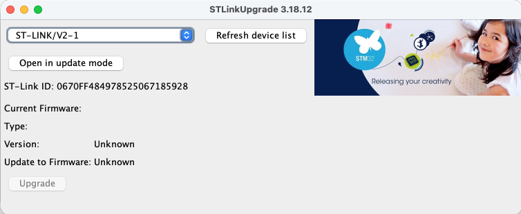
</p>

Since the "Version" and "Update to firmware" fields were empty, I clicked "Open in update mode". The interface then loaded the relevant information.

<p align="center">
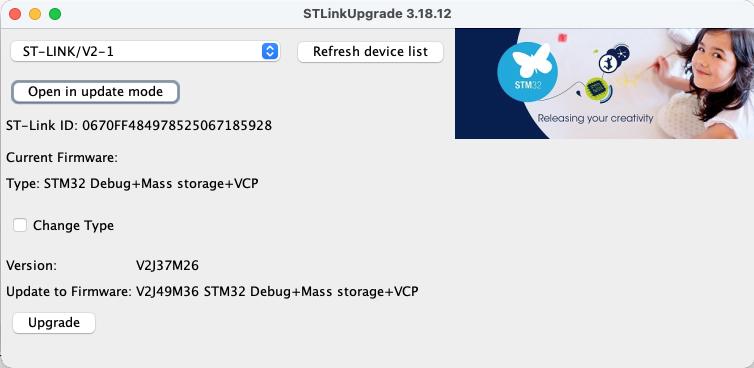
</p>

After completing the update, I clicked the green triangle again. The project compiled successfully, and the firmware was downloaded to the board.

<p align="center">
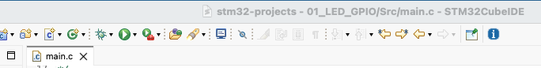
</p>

And that's it! The green LED is now on.

<p align="center">

</p>


# Summary & Conclusion

This first project provided a foundation for the projects that will follow. There was a lot to learn, especially since most of the tools and concepts were new to me:

1. How to connect the development board to the computer.
2. Which software to use to write, build, and run code on the board.
3. Which software to use to read and back up the contents of the board's Flash memory.
4. Which registers to modify to turn on an LED.
5. How to identify components on the development board.
6. How to find relevant information in the technical documentation.
7. How to add the necessary header files and configure the IDE.
8. How to build the project.
9. How to program the board with the compiled firmware.


## Steps to accomplish the first project

1. **Understand the relevant peripherals and registers:**
   - `RCC` — to enable the clock for the GPIO peripheral.
   - `GPIO` — to configure the pin using the mode register (`GPIOx_MODER`) and control its output using the bit set/reset register (`GPIOx_BSRR`).

2. **Set up the software tools:**
   - `STM32CubeIDE` — to write and build the code, and program the board.
   - `STM32CubeProgrammer` — to read and back up the board's Flash memory.
   - `ST-LINK Server` — to provide communication services for software accessing the onboard ST-LINK interface.

3. **Configure the project to use CMSIS:**
   - Add the CMSIS header files to the project and configure the IDE's include paths.
   - Include `system_stm32f4xx.c` to provide the system initialization and clock-related functions used by the project.
   - Use the CMSIS device definitions to access the hardware registers directly, without relying on HAL or LL drivers.


## Open subjects

There are still several topics I want to investigate in future projects. In particular, I want to understand the startup assembly code and the linker script in greater detail. Although I have a general idea of how they work, I would like to explore their roles more thoroughly.

I also want to learn more about the architecture of the STM32F407 and its peripherals. That will be the subject of future posts.


Once I have completed all the projects in this series using direct register access, I plan to go through them again using the LL and HAL drivers. This will give me an opportunity to compare the different levels of abstraction and better understand what these libraries provide.
